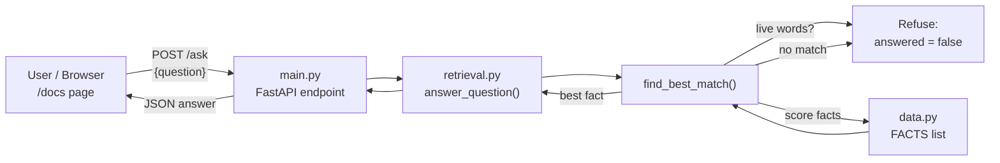

# ShirdiYatra Assistant - Day 5 (Complete Guide)

This README is both the project guide and a study note. After reading it you should be able to:

1. explain what the Day 5 task asks for and why,
2. explain how an LLM works in simple words,
3. explain every file in this project and what each function does,
4. run the FastAPI server and demo `/docs` at Checkpoint 1,
5. answer the questions a mentor may ask.

---

## Table of contents

1. [The Day 5 task in plain words](#1-the-day-5-task-in-plain-words)
2. [Deliverables checklist](#2-deliverables-checklist)
3. [Concepts you must understand](#3-concepts-you-must-understand)
4. [Project structure](#4-project-structure)
5. [How the whole system works (architecture and request flow)](#5-how-the-whole-system-works)
6. [File-by-file explanation](#6-file-by-file-explanation)
7. [Worked examples (tracing real questions)](#7-worked-examples)
8. [The 10 ShirdiYatra questions](#8-the-10-shirdiyatra-questions)
9. [How to run it (Checkpoint 1)](#9-how-to-run-it-checkpoint-1)
10. [Checkpoint 1 demo script](#10-checkpoint-1-demo-script)
11. [Git tag: checkpoint-1](#11-git-tag-checkpoint-1)
12. [Limitations and what to improve next](#12-limitations-and-what-to-improve-next)
13. [Viva / mentor questions with answers](#13-viva--mentor-questions-with-answers)
14. [Glossary](#14-glossary)

---

## 1. The Day 5 task in plain words

The task has three parts:

| Part | What it says | What it really means |
|------|--------------|----------------------|
| **A** | `docs/how_llms_work.md` in your own words with 1 diagram | Write a short explanation of how a Large Language Model works, without copying from the internet, and draw one diagram. |
| **B** | Add 10 real ShirdiYatra user questions (start with your card's 6; Q6 must be one your data cannot answer) | List 10 questions a real pilgrim would ask. The first ones come from your assigned card. **Question 6 must be something your dataset cannot answer.** |
| **C** | Checkpoint 1: run your FastAPI, show `/docs`, explain one function. Tag `checkpoint-1`. | Start your API server, open the automatic documentation page, explain one function from your code, and create a git tag called `checkpoint-1`. |

### Why is Q6 required to be unanswerable?

This is the most important idea in the task. A good AI product must know **what it does not know**. If your app confidently answers a question it has no data for, it is *hallucinating* (inventing an answer). A pilgrim asking "what is the queue time right now?" and getting a made-up "30 minutes" could waste hours or plan wrongly.

So Q6 proves that your system is **honest**: when the data cannot answer, it says so.

---

## 2. Deliverables checklist

- [x] `docs/how_llms_work.md` written in own words
- [x] One diagram inside that file (Mermaid flowchart)
- [x] 10 user questions listed
- [x] Q6 is a question the data cannot answer
- [x] FastAPI app runs with `uvicorn app.main:app --reload`
- [x] `/docs` page works (auto-generated by FastAPI)
- [x] One function chosen and explained (`find_best_match`)
- [x] Git tag `checkpoint-1`

> Remember: questions 1-5 in the doc are placeholders. Replace them with the questions from **your card** if they differ.

---

## 3. Concepts you must understand

### 3.1 What is an LLM?

A **Large Language Model** is a computer program trained on a very large amount of text. It learned one core skill: **given some text, predict the next piece of text.** Writing an answer is just doing that prediction again and again, one small piece at a time.

> Think of the autocomplete on your phone keyboard, but trained on a huge part of the internet and with a far better understanding of context.

### 3.2 Tokens

A model does not read letters or whole words. Text is split into **tokens**, which are small chunks: a word, part of a word, or punctuation. Each token is mapped to a number.

Example: `"Shirdi aarti time"` might become tokens like `Sh`, `irdi`, ` aarti`, ` time`.

Why it matters: models have a limit on how many tokens they can handle at once (the *context window*), and cost is often counted in tokens.

### 3.3 Embeddings

Each token number is converted into a long list of numbers called an **embedding** (a vector). Words used in similar ways get similar vectors. For example, "temple" and "mandir" land near each other. This is how a computer represents *meaning* using maths.

### 3.4 Attention and the Transformer

The main building block of modern LLMs is the **transformer**. Its key trick is **attention**: every token looks at every other token in the text and decides which ones are important for understanding it.

Example: in "The priest opened the door because *he* had the key", attention helps the word "he" connect to "priest", not "door".

A transformer stacks many such layers. After each layer, each token's vector carries more context about the whole sentence.

### 3.5 Predicting the next token

At the end, the model produces a **probability for every possible next token**. One token is chosen (with a bit of randomness controlled by *temperature*), added to the text, and the whole process repeats until the answer is complete.

### 3.6 Training

During **training**, the model reads text with the next word hidden, guesses it, and is corrected when wrong. This is repeated billions of times. Each correction slightly changes billions of numbers inside the network, called **weights**. The model's "knowledge" is stored in these weights.

After basic training, models are usually **fine-tuned** and improved with human feedback so they follow instructions politely and safely.

### 3.7 Why LLMs make mistakes (hallucination)

- An LLM generates **likely-sounding** text, not **verified** facts.
- Its knowledge stops at its **training cutoff date**, so it cannot know live things (today's queue, today's weather).
- It does not know your private or local data unless you provide it.

When it invents a confident but false answer, that is called a **hallucination**.

### 3.8 Grounding and RAG (the idea behind this project)

**RAG** means *Retrieval-Augmented Generation*:

1. **Retrieve**: first find the relevant facts from a trusted data source.
2. **Generate**: answer using only those facts.

This is called **grounding**: the answer is anchored to real data.

This project uses the *retrieval half* of that idea with a simple keyword search and **no LLM at all**. That keeps behaviour predictable and easy to explain. In a later day you could add an LLM on top that rewrites the retrieved fact into a friendly sentence.

### 3.9 Saying "I don't know"

A grounded system needs a rule for when retrieval fails. In this project there are two such rules:

1. **No keyword match** → "Sorry, I don't have that information."
2. **Live-information words** (`now`, `current`, `queue`, `wait`, ...) → refused, because a static dataset can never be correct about live status.

### 3.10 What is an API and what is FastAPI?

- An **API** lets one program talk to another over HTTP (for example a mobile app asking your server a question).
- **FastAPI** is a Python framework to build APIs quickly.
- **Endpoint / route**: a URL plus an HTTP method, such as `POST /ask`.
- **Pydantic model**: a class that describes the shape of the data going in and out; FastAPI uses it to validate input automatically.
- **Uvicorn**: the server program that actually runs your FastAPI app.
- **`/docs`**: FastAPI automatically builds an interactive documentation page (Swagger UI) from your code, where you can test every endpoint in the browser.

---

## 4. Project structure

```
day-05/
├── README.md              <- this guide
├── requirements.txt       <- Python packages needed
├── .gitignore             <- files git should ignore (.venv, __pycache__)
├── app/
│   ├── __init__.py        <- empty file; makes "app" a Python package
│   ├── data.py            <- the knowledge base (facts)
│   ├── retrieval.py       <- search logic (the "brain")
│   └── main.py            <- FastAPI app and endpoints
└── docs/
    └── how_llms_work.md   <- Day 5 written deliverable
```

### Who depends on whom

```
main.py  --->  retrieval.py  --->  data.py
(web layer)    (logic layer)       (data layer)
```

Each layer has one job. `main.py` never searches data itself, and `data.py` has no logic. This separation makes each part easy to test and replace later (for example, swapping `data.py` for a database).

---

## 5. How the whole system works

### 5.1 Architecture diagram



### 5.2 Request flow step by step

1. The user sends `POST /ask` with `{"question": "..."}`.
2. FastAPI checks the body against the `Question` model (must have a `question` string of at least 2 characters). If invalid, FastAPI returns an error automatically.
3. `ask()` in `main.py` calls `answer_question()` in `retrieval.py`.
4. `answer_question()` calls `find_best_match()`.
5. `find_best_match()` turns the question into clean words, checks for live-info words, then scores every fact in `FACTS`.
6. The best fact (or "not found") goes back up the chain.
7. FastAPI shapes the result with the `Answer` model and returns JSON.

---

## 6. File-by-file explanation

### 6.1 `app/data.py` - the knowledge base

Contains one list named `FACTS`. Each item is a dictionary:

| Key | Meaning |
|-----|---------|
| `id` | A short unique name, like `aarti_timings`. Returned as the `source` so you can see *where the answer came from*. |
| `keywords` | Lowercase words that signal this fact is relevant. |
| `answer` | The text shown to the user. |

Current topics: `aarti_timings`, `darshan_timings`, `pune_to_shirdi`, `stay`, `nearest_station_airport`, `nearby_places`, `dress_code`, `online_booking`, `food`.

> The content is sample data written from general knowledge. Always confirm timings and booking details with the official Shri Saibaba Sansthan website (sai.org.in).

**To add knowledge:** add a new dictionary to `FACTS`. No other file needs to change.

### 6.2 `app/retrieval.py` - the brain

Constants:

- `STOPWORDS`: very common words (`the`, `is`, `what`...) that are ignored because they do not help find a topic.
- `LIVE_WORDS`: words meaning the user wants real-time information.
- `NOT_FOUND`: the standard "I don't know" message.

Functions:

**`tokenize(text)`**
Lowercases the text, pulls out only letters-words with a regular expression, and removes stopwords.
`"What time is the Kakad aarti?"` → `["time", "kakad", "aarti"]`

**`find_best_match(question)`**
Returns `(best_fact, score)` or `(None, 0)`.
1. Tokenizes the question into a set of words.
2. If any word is in `LIVE_WORDS` → return `(None, 0)`.
3. For each fact, score = number of question words found in that fact's `keywords`.
4. Keep the fact with the highest score. If nothing scores above 0, the result stays `None`.

**`answer_question(question)`**
Wraps the above and always returns a dictionary:
`{"answered": bool, "answer": str, "source": str | None, "score": int}`.

### 6.3 `app/main.py` - the FastAPI app

- `app = FastAPI(...)`: creates the application with a title, description and version, which appear on `/docs`.
- `class Question(BaseModel)`: the input shape. `Field(..., min_length=2)` means the field is required and must have at least 2 characters.
- `class Answer(BaseModel)`: the output shape (`answered`, `answer`, `source`, `score`).
- `GET /health`: returns `{"status": "ok", "facts_loaded": N}`. Used to check the server is alive.
- `GET /topics`: returns the list of fact ids the app knows.
- `POST /ask`: the main endpoint. Takes a `Question`, returns an `Answer`.

The text inside each function (the docstring) is shown on `/docs` as the endpoint description.

### 6.4 `docs/how_llms_work.md`

The written deliverable: explanation of LLMs in own words, one Mermaid diagram, and the table of 10 questions.

### 6.5 `requirements.txt`

```
fastapi>=0.110
uvicorn[standard]>=0.29
```

### 6.6 `.gitignore`

Tells git not to track the virtual environment (`.venv/`) or Python cache folders (`__pycache__/`).

---

## 7. Worked examples

### Example 1 - a normal question

Question: **"What time is the Kakad (morning) aarti?"**

1. After tokenizing: `time`, `kakad`, `morning`, `aarti`.
2. No live words.
3. Scores: `aarti_timings` matches `kakad`, `morning`, `aarti` → **3**. Other facts score 0.
4. Result: the aarti timings answer, `source = "aarti_timings"`.

### Example 2 - a bug that was found and fixed

Question: **"Where can I stay near the temple?"**

Originally `temple` was a keyword for `darshan_timings`. After tokenizing the question gives `stay`, `temple`:

- `stay` fact: 1 (`stay`)
- `darshan_timings`: 1 (`temple`)

A tie! The first fact in the list won, so the user got *darshan timings* for a *stay* question. **Fix:** remove the generic word `temple` from `darshan_timings` keywords (replaced with `mandir`). Now `stay` wins.

Lesson: keyword search is simple but sensitive to ambiguous words. Testing all your questions before the demo catches this.

### Example 3 - Q6, the unanswerable question

Question: **"What is the current darshan queue wait time right now?"**

1. Tokenized words include `current`, `queue`, `wait`, `now`.
2. These are in `LIVE_WORDS` → `find_best_match` returns `(None, 0)` immediately.
3. Response: `answered: false` with the "Sorry, I don't have that information" message.

Notice that even though the word `darshan` exists in the data, the app does **not** return darshan timings, because timings are not queue length. Refusing is correct.

---

## 8. The 10 ShirdiYatra questions

| # | Question | Answerable? | Fact used |
|---|----------|-------------|-----------|
| 1 | What time is the Kakad (morning) aarti? | Yes | `aarti_timings` |
| 2 | What are the temple darshan timings? | Yes | `darshan_timings` |
| 3 | How do I reach Shirdi from Pune? | Yes | `pune_to_shirdi` |
| 4 | Where can I stay near the temple? | Yes | `stay` |
| 5 | What is the nearest railway station and airport? | Yes | `nearest_station_airport` |
| **6** | **What is the current darshan queue wait time right now?** | **No (live data)** | none |
| 7 | What other places can I visit nearby? | Yes | `nearby_places` |
| 8 | Is there a dress code for the temple? | Yes | `dress_code` |
| 9 | Can I book a darshan pass online? | Yes | `online_booking` |
| 10 | Is food available for devotees? | Yes | `food` |

Q1-Q5 are placeholders for your card's questions. If your card differs, change them in `docs/how_llms_work.md` **and** make sure `data.py` has facts that can answer them (except Q6).

---

## 9. How to run it (Checkpoint 1)

Requirements: Python 3.10 or newer.

```bash
cd day-05

# 1. create an isolated environment
python -m venv .venv

# 2. activate it
source .venv/bin/activate          # Mac / Linux
.venv\Scripts\activate             # Windows

# 3. install packages
pip install -r requirements.txt

# 4. start the server
uvicorn app.main:app --reload
```

Meaning of the last command:

- `uvicorn` - the server program
- `app.main` - the file `app/main.py`
- `:app` - the variable named `app` inside it
- `--reload` - restart automatically when you edit code

Open: **http://127.0.0.1:8000/docs**

### Test from the terminal (optional)

```bash
curl -X POST http://127.0.0.1:8000/ask \
  -H "Content-Type: application/json" \
  -d '{"question": "What time is the Kakad aarti?"}'
```

Expected shape:

```json
{
  "answered": true,
  "answer": "Four aartis are held daily: ...",
  "source": "aarti_timings",
  "score": 3
}
```

### Common problems

| Problem | Fix |
|---------|-----|
| `ModuleNotFoundError: No module named 'app'` | Run `uvicorn` from the project root folder (the one that contains `app/`). |
| `uvicorn: command not found` | Activate the virtual environment first. |
| Port already in use | Use `uvicorn app.main:app --reload --port 8001`. |
| Python version error on `str | None` | Use Python 3.10+. |

---

## 10. Checkpoint 1 demo script

Follow this order so the demo is smooth:

1. **Start the server** and show it running in the terminal.
2. **Open `/docs`** and say: "FastAPI builds this page automatically from my code and type models."
3. Expand `GET /health` → *Try it out* → *Execute*. Show `status: ok`.
4. Expand `POST /ask` → try **Q1**. Point out `answered: true` and `source`.
5. Try **Q6** (the live queue question). Point out `answered: false`: "My data cannot answer this, so it refuses instead of inventing."
6. **Explain one function**: open `find_best_match` and walk through its 4 steps (see below).
7. Show `git tag` listing `checkpoint-1`.

### Explaining `find_best_match` in 30 seconds

> "This function receives the user's question and returns the best matching fact. First it cleans the question into meaningful words. Then it checks for words like *now* or *queue*; those mean live information, which my static data can never know, so it returns nothing instead of guessing. Otherwise it loops through every fact and counts how many question words match that fact's keywords. The fact with the highest count wins. If nothing matches, it returns None and the API says it doesn't know."

---

## 11. Git tag: checkpoint-1

A **tag** is a permanent label on a specific commit, used to mark milestones.

```bash
git init                      # only if the folder is not a repo yet
git add -A
git commit -m "Day 5: LLM doc, FastAPI app, README"
git tag checkpoint-1
git tag                       # should list: checkpoint-1
git push origin main --tags   # only if you have a remote (e.g. GitHub)
```

If you change files after tagging and want the tag to include them:

```bash
git add -A && git commit -m "Update"
git tag -f checkpoint-1       # moves the tag to the latest commit
```

---

## 12. Limitations and what to improve next

| Limitation | Why it happens | Possible improvement |
|------------|----------------|----------------------|
| Matching is by exact keyword | No understanding of meaning or spelling mistakes | Use embeddings (semantic search) |
| Ties go to the first fact | Simple scoring | Add weights or a tie-break rule |
| Only one fact returned | Simple design | Return top 3 matches |
| Static data only | Stored in a Python list | Move to a database or the official source |
| No natural language in answer | No LLM involved | Add an LLM that rewrites the retrieved fact (full RAG) |
| Live-word list is small | Hand-written | Expand the list or classify intent |

---

## 13. Viva / mentor questions with answers

**Q: What is an LLM in one line?**
A program trained on huge text that predicts the next token, repeated to produce answers.

**Q: What is a token?**
A small chunk of text (word piece) converted to a number so the model can process it.

**Q: What does attention do?**
It lets each token look at all other tokens and focus on the ones that matter for its meaning.

**Q: What is hallucination and how does your project avoid it?**
Hallucination is confident but false output. This project answers only from a fixed dataset and refuses when the data has no answer or the question needs live information.

**Q: What is RAG?**
Retrieve relevant facts first, then generate the answer from them. This project implements the retrieval part.

**Q: Why is Q6 unanswerable?**
Queue wait time changes every minute and is not in the static dataset. The correct behaviour is to say "I don't know".

**Q: Why no LLM in this version?**
To keep behaviour predictable, testable and easy to explain at Day 5. An LLM can be added later on top of the retrieval.

**Q: What does `/docs` show and who writes it?**
An interactive Swagger UI generated automatically by FastAPI from the route functions, Pydantic models and docstrings.

**Q: What is Pydantic used for here?**
`Question` validates incoming JSON; `Answer` defines the response shape.

**Q: What is the difference between GET and POST?**
GET reads data (`/health`, `/topics`); POST sends data to be processed (`/ask` sends a question in the body).

**Q: What is a stopword?**
A very common word (the, is, what) removed because it does not help identify the topic.

**Q: What bug did you find while testing?**
"Stay near the temple" matched darshan timings because `temple` was a shared keyword and ties went to the first fact. I removed the ambiguous keyword.

---

## 14. Glossary

| Term | Meaning |
|------|---------|
| LLM | Large Language Model, a text-predicting neural network |
| Token | Small unit of text the model processes |
| Embedding | List of numbers representing a token's meaning |
| Transformer | Neural network design based on attention |
| Attention | Mechanism letting tokens focus on relevant other tokens |
| Weights | Numbers inside the model learned during training |
| Training cutoff | Date after which the model has seen no new data |
| Temperature | Setting controlling randomness of token choice |
| Hallucination | Confident but invented or false output |
| Grounding | Basing answers on trusted data |
| RAG | Retrieval-Augmented Generation |
| Retrieval | Finding relevant facts for a question |
| API | Interface for programs to communicate |
| Endpoint | URL + HTTP method, e.g. `POST /ask` |
| FastAPI | Python web framework for APIs |
| Uvicorn | Server that runs FastAPI apps |
| Pydantic | Library for data validation and models |
| Swagger UI | The interactive `/docs` page |
| Stopword | Common word ignored in matching |
| Git tag | Named marker on a commit (`checkpoint-1`) |

---

*Data in this project is sample content for a learning exercise. Verify real timings and bookings with the official Shri Saibaba Sansthan (sai.org.in).*