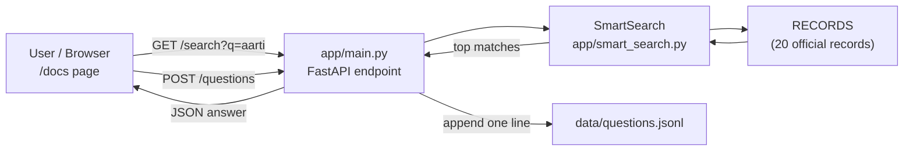

# ShirdiYatra Assistant
 
A small Python project that helps a pilgrim plan a visit to Shirdi using **official Sai Sansthan information** (sai.org.in): aarti and darshan timings, Sansthan rooms, and how to reach.
 
**Target visitor:** a family of 7 from Hyderabad (with grandparents) on a first 2-day trip, travelling by train to Kopargaon and staying in Sansthan rooms.
 
**Author:** Sayali Rajendra Pawar (CSE, SJ-50) | **Domain:** Travel and culture
 
> Data is collected from official Sansthan pages. Always confirm timings and prices on https://sai.org.in before travelling.
 
---
 
## Table of contents
 
1. [What this project does](#1-what-this-project-does)
2. [Progress so far (Day 1 to Day 5)](#2-progress-so-far-day-1-to-day-5)
3. [Day 5 task and what was done](#3-day-5-task-and-what-was-done)
4. [Project structure](#4-project-structure)
5. [How the system works](#5-how-the-system-works)
6. [The API endpoints](#6-the-api-endpoints)
7. [The docs folder: how LLMs work](#7-the-docs-folder-how-llms-work)
8. [The eval folder: the 10 questions](#8-the-eval-folder-the-10-questions)
9. [How to run it (Checkpoint 1)](#9-how-to-run-it-checkpoint-1)
10. [Checkpoint 1 demo script](#10-checkpoint-1-demo-script)
11. [Git commits and the checkpoint-1 tag](#11-git-commits-and-the-checkpoint-1-tag)
12. [Limitations and next steps](#12-limitations-and-next-steps)
13. [Mentor questions with answers](#13-mentor-questions-with-answers)
14. [Glossary](#14-glossary)
---
 
## 1. What this project does
 
The project reads a set of records about Shirdi (daily programme timings and Sansthan room tariffs) and lets a user:
 
- **search** the records with a keyword or question,
- **look up** one record by its id,
- **send a question** to the API, which saves it and suggests the 3 best matching records,
- see all of this in the automatic **/docs** page made by FastAPI.
Each record has these fields: `topic`, `place_or_service`, `timing`, `cost_inr`, `rule_or_tip`, `source_url`. There are **20 records**: 12 daily programme rows and 8 room types (Sai Bhakta Niwas and Sai Ashram tariff).
 
**Planned wow feature:** a one-day Shirdi timeline card with the train arrival marked, and a `plan_sansthan_rooms` tool that finds the cheapest room mix for the group (no single-person rooms, 24 to 48 hour stay).
 
---
 
## 2. Progress so far (Day 1 to Day 5)
 
| Day | Topic | What was built |
|-----|-------|----------------|
| Day 1 | Intro | Project card (this README), `day01_intro.py`, `day01_menu.py` |
| Day 2 | Records and CLI | `data/sample_records.json`, `app/records.py` (load, search, count_by, get_by_id), `app/cli.py` |
| Day 3 | Real data, files, errors, classes | `app/fetch.py` (downloads official pages), `app/ingest.py`, `app/models.py`, real records in `data/` |
| Day 4 | FastAPI | `app/main.py` with `/health`, `/records`, `/search`, `/questions`, and `app/smart_search.py` |
| **Day 5** | **LLM concepts, evaluation questions, Checkpoint 1** | **`docs/how_llms_work.md`, `eval/questions.md`, `/docs` demo, tag `checkpoint-1`** |
 
---
 
## 3. Day 5 task and what was done
 
The task has three parts.
 
| Part | Requirement | Status | Where |
|------|-------------|--------|-------|
| A | `docs/how_llms_work.md` in own words with 1 diagram | Done | `docs/how_llms_work.md` |
| B | 10 real ShirdiYatra user questions, Q6 must be one the data cannot answer | Done | `eval/questions.md` and section 8 below |
| C | Checkpoint 1: run FastAPI, show `/docs`, explain one function, tag `checkpoint-1` | Done | section 9, 10 and 11 |
 
### Why must Q6 be unanswerable?
 
A good AI product must know **what it does not know**. If an app answers a question it has no data for, it is *hallucinating* (inventing an answer). A pilgrim who gets a made-up queue time or hotel price may plan wrongly. Q6 proves the system is honest: when the data cannot answer, it should say so.
 
---
 
## 4. Project structure
 
```
GenAI_EXmate_04_clean/
├── README.md                <- this guide
├── requirements.txt         <- Python packages (fastapi, uvicorn, ...)
├── .gitignore               <- ignore .venv and __pycache__
├── app/
│   ├── main.py              <- FastAPI application (Day 4)
│   ├── smart_search.py      <- SmartSearch class + load_default()
│   ├── records.py           <- load_records, search, count_by, get_by_id
│   ├── models.py            <- record classes
│   ├── fetch.py             <- downloads official Sansthan pages
│   ├── ingest.py            <- turns raw pages into records
│   └── cli.py               <- command-line menu
├── data/
│   ├── raw/                 <- downloaded pages
│   ├── records.json         <- the 20 cleaned records
│   └── questions.jsonl      <- questions saved by POST /questions
├── docs/
│   └── how_llms_work.md     <- Day 5: how an LLM works + diagram
├── eval/
│   └── questions.md         <- Day 5: the 10 evaluation questions
├── tests/
└── day01 ... day06/         <- daily task folders
```
 
---
 
## 5. How the system works
 

 
**Request flow for `GET /search?q=aarti`:**
 
1. The user sends the request (from `/docs` or a browser).
2. FastAPI checks the input: `q` must be at least 1 character, `limit` must be between 1 and 20.
3. `search()` in `main.py` asks `SmartSearch` for the best `top_k` records.
4. The result goes back as JSON: `{"query": "aarti", "results": [...]}`.
**Layers:** `main.py` (web layer) calls `smart_search.py` (search layer), which works on the records (data layer). Each layer has one job, so each can be changed without breaking the others.
 
---
 
## 6. The API endpoints
 
| Method | URL | What it does |
|--------|-----|--------------|
| GET | `/health` | Shows `status: ok` and how many records are loaded |
| GET | `/records?limit=10` | Returns the first `limit` records (1 to 100) |
| GET | `/records/{record_id}` | Returns one record, or 404 "Record not found" |
| GET | `/search?q=...&limit=5` | Returns the best matching records for a word or question |
| POST | `/questions` | Saves a question and returns 3 suggested records |
 
### Code details in `app/main.py`
 
- `RECORDS = load_default()` loads the data once when the server starts.
- `SEARCH = SmartSearch(RECORDS)` builds the search engine once.
- `app = FastAPI(title="ShirdiYatra API", version="0.1.0")` creates the app; the title and version appear on `/docs`.
- **CORS middleware** allows a web page on `http://localhost:5500` or `http://127.0.0.1:5500` (for example the VS Code Live Server) to call the API.
- `class QuestionIn(BaseModel)` is the input shape for `POST /questions`: `question` is required (3 to 500 characters), `asked_by` is optional (up to 80 characters). FastAPI rejects bad input automatically with an error.
### The function explained at Checkpoint 1: `post_question`
 
```python
@app.post("/questions", status_code=201)
def post_question(payload: QuestionIn):
    entry = {"asked_at": datetime.now(timezone.utc).isoformat(), **payload.model_dump()}
    QUESTIONS_FILE.parent.mkdir(parents=True, exist_ok=True)
    with QUESTIONS_FILE.open("a", encoding="utf-8") as f:
        f.write(json.dumps(entry, ensure_ascii=False) + "\n")
    return {"saved": True, "question": payload.question,
            "suggested_records": SEARCH.search(payload.question, top_k=3)}
```
 
- **Input:** a question (3 to 500 letters) and optionally the name of the person asking.
- **What it does:** adds the current UTC time, then appends the question as one new line in `data/questions.jsonl` (a log of what real users ask).
- **Output:** status 201 (Created), `saved: true`, the question, and the 3 best matching records.
- **Why it matters:** the saved questions show what visitors really ask, which is exactly what the `eval/` questions are for.
---
 
## 7. The docs folder: how LLMs work
 
`docs/how_llms_work.md` explains, in simple words, how a Large Language Model works. It has one diagram:
 

 
### Summary of the idea
 
1. **Prompt:** the user writes a question.
2. **Tokens:** the text is cut into small pieces and each piece becomes a number.
3. **Model:** the model gives a probability to every possible next token.
4. **Next token:** one token is picked and added; the model repeats until the answer is complete.
### Key points
 
- An LLM predicts likely text; it does not look facts up. So it can **hallucinate**.
- It only knows what it learned before its **training cutoff**, so it cannot know today's timings or room prices.
- **Fix used in this project:** keep the facts in our own official data and search it (retrieval) instead of trusting a model's memory. Adding an LLM later on top of the retrieved records is called **RAG** (Retrieval-Augmented Generation).
---
 
## 8. The eval folder: the 10 questions
 
`eval/questions.md` holds 10 real questions a visitor would ask. It is a test set: after any change to the data or the search, run these questions again to see if answers got better or worse.
 
| # | Question | Answerable from our data? |
|---|----------|---------------------------|
| 1 | What time is the Kakad aarti at Shirdi? | Yes (daily programme) |
| 2 | What are the darshan timings for Shirdi Sai Baba temple? | Yes (daily programme) |
| 3 | How can a family of 7 reach Shirdi from Hyderabad by train? | Check with `/search` |
| 4 | Which railway station is nearest to Shirdi, and how far is it from the temple? | Check with `/search` |
| 5 | How much does a Sansthan room at Sai Bhakta Niwas cost? | Yes (room tariff) |
| **6** | **Which private hotel near Shirdi has a swimming pool, and what is its price?** | **No. Our data has only Sansthan rooms and no private hotels.** |
| 7 | What are the timings of the Madhyan (noon) aarti? | Yes (daily programme) |
| 8 | Can a single person book a room in Sansthan accommodation? | Check with `/search` |
| 9 | What is the cheapest room mix for 7 people staying 2 days? | Needs the `plan_sansthan_rooms` tool |
| 10 | What time is the Shej (night) aarti, and when does the temple close? | Yes (daily programme) |
 
### How to test the questions
 
1. Start the server (section 9) and open `/docs`.
2. Open `GET /search`, click **Try it out**, paste a keyword from the question (for example `Kakad aarti` or `Sai Bhakta Niwas`), and click **Execute**.
3. Decide: does the top result really answer the question? Write Yes or No.
4. **Q6 must stay "No".** If your search returns a confident-looking record for the swimming pool question, that is a problem to fix later (for example, a minimum score before returning a result).
---
 
## 9. How to run it (Checkpoint 1)
 
Requirements: Python 3.10 or newer.
 
```bash
# from the project root folder (the one that contains app/)
 
# 1. create and activate the virtual environment (once)
python -m venv .venv
.venv\Scripts\activate             # Windows
source .venv/bin/activate          # Mac / Linux
 
# 2. install packages
pip install -r requirements.txt
 
# 3. start the server
uvicorn app.main:app --reload
```
 
What the last command means:
 
- `uvicorn` is the server program,
- `app.main` is the file `app/main.py`,
- `:app` is the variable named `app` inside it,
- `--reload` restarts the server when you edit code.
Open **http://127.0.0.1:8000/docs**
 
### Common problems
 
| Problem | Fix |
|---------|-----|
| `Could not import module "main"` | You used the wrong command. Use `uvicorn app.main:app --reload`. |
| `ModuleNotFoundError: No module named 'app'` | Run the command from the project root, not from inside `app/`. |
| `No module named 'fastapi'` | Activate `.venv` and run `pip install fastapi "uvicorn[standard]"`. |
| `uvicorn` not found | Activate the virtual environment first. |
| Port already in use | Add `--port 8001`. |
| PowerShell blocks `Activate.ps1` | Run `Set-ExecutionPolicy -Scope Process -ExecutionPolicy RemoteSigned` first. |
 
---
 
## 10. Checkpoint 1 demo script
 
1. **Start the server** and show it running in the terminal.
2. **Open `/docs`** and say: "FastAPI builds this page automatically from my code and my type models."
3. Open `GET /health`, click *Try it out* then *Execute*. Show `status: ok` and the record count.
4. Open `GET /search`, try `aarti`. Show the matching records.
5. Try the **Q6 style question** and show that the data cannot answer it.
6. **Explain one function:** `post_question` (section 6). Say: input, what it does, output.
7. Show `git tag` listing `checkpoint-1`.
### 30-second explanation
 
> "`post_question` receives a visitor's question. FastAPI first checks it is between 3 and 500 characters. The function adds the current time and saves the question as one line in `questions.jsonl`, so I can see what real visitors ask. Then it searches my official records and returns the 3 best matches together with `saved: true`."
 
---
 
## 11. Git commits and the checkpoint-1 tag
 
Day 5 commit message must start with `day-05:`.
 
```bash
git add docs eval README.md
git commit -m "day-05: add how_llms_work doc, eval questions and full README"
git push
 
git tag checkpoint-1
git push origin checkpoint-1
```
 
If you change files after tagging and want the tag to include them:
 
```bash
git add -A
git commit -m "day-05: update"
git push
git tag -f checkpoint-1
git push -f origin checkpoint-1
```
 
The whole repo is re-checked every morning, so an earlier day turns OK once its files are pushed.
 
---
 
## 12. Limitations and next steps
 
| Limitation | Next step |
|------------|-----------|
| Search is based on the words in the records and may miss a different wording | Add semantic search (embeddings) |
| Q6-type questions still return the "closest" records | Add a minimum score; below it, answer "I don't have that information" |
| Data is static (checked on a date) | Re-run `fetch.py` regularly and show the "checked on" date |
| No natural-language answer | Add an LLM that rewrites the retrieved record (full RAG) |
| Room planning not exposed in the API | Add `plan_sansthan_rooms` as an endpoint |
 
---
 
## 13. Mentor questions with answers
 
**What is an LLM in one line?**
A program trained on huge text that predicts the next token, repeated to produce an answer.
 
**What is a token?**
A small chunk of text (a word or part of a word) turned into a number.
 
**What is hallucination, and how does this project reduce it?**
Hallucination is a confident but false answer. This project answers from official records only, and Q6 shows what happens when the data has no answer.
 
**What is RAG?**
Retrieve relevant facts first, then generate the answer from them. This project has the retrieval part.
 
**Why must Q6 be unanswerable?**
To prove the system can say "I don't know" instead of inventing something.
 
**What does `/docs` show and who writes it?**
An interactive Swagger page that FastAPI generates from the route functions, type models and docstrings.
 
**What is Pydantic used for here?**
`QuestionIn` checks the incoming JSON (length rules) before the function runs.
 
**GET vs POST?**
GET reads data (`/health`, `/records`, `/search`). POST sends data to be processed (`/questions`).
 
**Why is the question saved to a `.jsonl` file?**
Each line is one JSON object, so new questions can be appended easily and read later as a log.
 
**What is a git tag?**
A permanent label on one commit to mark a milestone, like `checkpoint-1`.
 
---
 
## 14. Glossary
 
| Term | Meaning |
|------|---------|
| LLM | Large Language Model, a text-predicting neural network |
| Token | Small unit of text the model processes |
| Hallucination | Confident but invented or false output |
| Training cutoff | Date after which the model has seen no new data |
| Grounding | Basing answers on trusted data |
| RAG | Retrieval-Augmented Generation |
| Retrieval | Finding the relevant records for a question |
| API | Way for programs to talk to each other |
| Endpoint | URL plus method, for example `GET /search` |
| FastAPI | Python framework for building APIs |
| Uvicorn | Server that runs a FastAPI app |
| Pydantic | Library that validates data using classes |
| Swagger UI | The interactive `/docs` page |
| CORS | Rule that decides which web pages may call the API |
| JSONL | Text file with one JSON object per line |
| Git tag | Named marker on a commit |
 
---
 
*Sources: official Shri Saibaba Sansthan pages (sai.org.in). Verify timings and prices before travelling.*