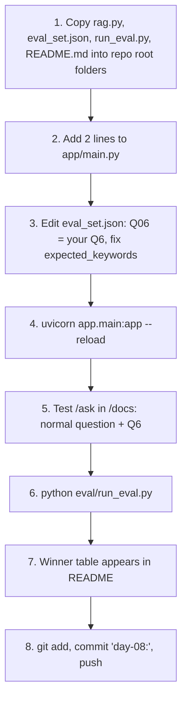
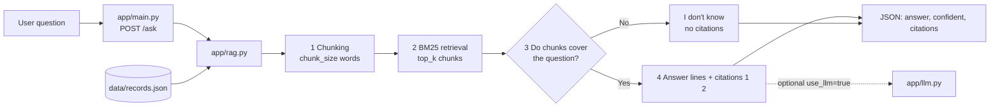
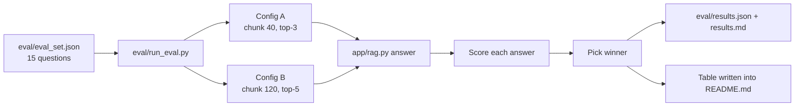

# ShirdiYatra - Day 08 (Mon 16 Nov): RAG answers with citations + evaluation

| | |
|---|---|
| **Project** | ShirdiYatra (`sanjivani-sj-50-shirdiyatra`), domain: Travel & culture |
| **Repo** | https://github.com/THESAYALI/GenAI_EXmate_04 |
| **Student** | Sayali Rajendra Pawar, CSE, SJ-50 |
| **Day** | D8 - Mon 16 Nov |
| **Data source** | Official Sansthan pages only (sai.org.in): `/en/faq`, `/en/daily-programme`, how-to-reach, accommodations |

---

## Table of contents

1. [Project idea and persona](#1-project-idea-and-persona)
2. [Project journey D1 to D8](#2-project-journey-d1-to-d8)
3. [Day 08 task](#3-day-08-task)
4. [Key words explained](#4-key-words-explained)
5. [Folder diagram - where every file is saved](#5-folder-diagram---where-every-file-is-saved)
6. [What each file is, why it is needed, where it works](#6-what-each-file-is-why-it-is-needed-where-it-works)
7. [Task flow - what you do, in order](#7-task-flow---what-you-do-in-order)
8. [File flow - what happens on every /ask call](#8-file-flow---what-happens-on-every-ask-call)
9. [Data format (records.json)](#9-data-format-recordsjson)
10. [How app/rag.py works (function by function)](#10-how-apprag-py-works-function-by-function)
11. [The "I don't know" rule (Q6)](#11-the-i-dont-know-rule-q6)
12. [API reference - POST /ask](#12-api-reference---post-ask)
13. [Setup and run](#13-setup-and-run)
14. [Test cases](#14-test-cases)
15. [Evaluation (S2)](#15-evaluation-s2)
16. [Results - winner table](#16-results---winner-table)
17. [Configuration you can change](#17-configuration-you-can-change)
18. [Limitations and future work](#18-limitations-and-future-work)
19. [Checklist before submit](#19-checklist-before-submit)
20. [Git commands](#20-git-commands)
21. [Troubleshooting](#21-troubleshooting)
22. [Viva / explain-it questions](#22-viva--explain-it-questions)

---

## 1. Project idea and persona

ShirdiYatra helps a visitor plan a Shirdi trip using **only official Sansthan pages**.
It answers: aarti and darshan timings, which Sansthan rooms suit a group and budget, and how to reach Shirdi.

**Target persona:** a family of 7 from Hyderabad (grandparents included), first 2-day trip, train to Kopargaon, wants Sansthan rooms.

**Record fields** (20 records = 12 daily-programme rows + 8 room types from Sai Bhakta Niwas / Sai Ashram tariff):
`topic, place_or_service, timing, cost_inr, rule_or_tip, source_url` (+ a `checked_on` date per record).

**Wow feature:** a one-day Shirdi timeline card with the train arrival marked, and the tool `plan_sansthan_rooms` (cheapest room mix, no single-person rooms, 24-48 hour stay).

---

## 2. Project journey D1 to D8

| Day | Date | What was built |
|---|---|---|
| D1 | | `README.md` project card, `day01_intro.py`, `day01_menu.py` |
| D2 | Thu 5 Nov | `data/sample_records.json`, `app/records.py` (load, search, count_by, get_by_id), `app/cli.py` |
| D3 | Fri 6 Nov | Real data: `app/fetch.py`, `app/ingest.py`, `app/models.py`, `data/raw`, `data/records.json` |
| D4 | | FastAPI `app/main.py`: `/health`, `/records`, `/records/{id}`, `/search`, `POST /questions` (SmartSearch) |
| D5 | Thu 12 Nov | `docs/how_llms_work.md`, 10 real questions in `eval/questions.md` (Q6 = data cannot answer), checkpoint-1 |
| D6 | Fri 13 Nov | `app/llm.py` provider wrapper (Groq/Gemini), `POST /chat`, `prompts/` folder, `eval/prompt_compare.md` |
| D7 | Sat 14 Nov | `app/chunking.py`, `app/embed.py`, `app/vectorstore.py` (Chroma), `GET /search/semantic?q=` |
| **D8** | **Mon 16 Nov** | **`app/rag.py` + `POST /ask` with citations and "I don't know"; `eval/eval_set.json` + `eval/run_eval.py`; 2 configs; winner table** |

D8 builds on D5 (the Q6 idea), D6 (optional LLM) and D3/D4 (records + FastAPI).

---

## 3. Day 08 task

| Step | Task | Done by |
|---|---|---|
| **S1** | `app/rag.py` + `POST /ask`: answer ShirdiYatra questions **from retrieved chunks, with citations**. It **must say "I don't know" for Q6**. | `app/rag.py` |
| **S2** | `eval/eval_set.json` (**15 rows**) + `eval/run_eval.py`. Run **2 configs (chunk size / top-k)** and put the **winner table in the README**. | `eval/eval_set.json`, `eval/run_eval.py` |

**Why this day matters:** before D8 the project could only *search*. Now it *answers*, shows *where* each answer came from, *refuses* when it does not know, and is *measured* so you can prove which settings are better.

---

## 4. Key words explained

| Word | Simple meaning |
|---|---|
| **RAG** (Retrieval-Augmented Generation) | First *retrieve* the relevant pieces of your data, then *answer* using only those pieces. Stops the system from inventing facts. |
| **Chunk** | A small piece of the data (here: a group of record lines of about `chunk_size` words). Retrieval works on chunks. |
| **chunk_size** | Max words per chunk. Small = precise but little context. Big = more context but more noise. |
| **top_k** | How many best-matching chunks are used for the answer. |
| **BM25** | A classic keyword ranking formula. Chunks that contain the question's rare words many times score higher. |
| **Citation** | A number like `[1]` in the answer that points to the `source_url` the information came from. |
| **Grounded answer** | An answer that is supported by the retrieved chunks, nothing else. |
| **Hallucination** | When a system makes up an answer. The "I don't know" gate prevents it. |
| **Eval set** | A fixed list of test questions with expected results, used as an exam for the system. |
| **Config** | One combination of settings (chunk_size + top_k) that is tested. |

---

## 5. Folder diagram - where every file is saved

Everything lives in the **repo root**: `C:\Users\Sayali Pawar\Desktop\GenAI_EXmate_04_clean`
Do **not** put `app/`, `data/` or `eval/` inside a `day08` folder - the checker looks in the root.

```
GenAI_EXmate_04_clean\            <- repo root (run every command from here)
|
|-- README.md                     [D8 NEW]  this file
|-- requirements.txt              [old]     fastapi, uvicorn, pydantic ...
|-- .env                          [old]     API keys - NEVER commit
|-- .env.example                  [old]     committed template
|-- .gitignore                    [old]
|
|-- docs\
|   `-- how_llms_work.md          [old D5]
|
|-- prompts\                      [old D6]  system + task prompts
|
|-- data\
|   |-- raw\                      [old D3]  downloaded sai.org.in pages
|   |-- questions.jsonl           [old D4]
|   `-- records.json              [old]     20 records   <== INPUT of D8
|
|-- app\
|   |-- main.py                   [EDIT D8] FastAPI app, +2 lines for /ask
|   |-- rag.py                    [D8 NEW]  chunk -> retrieve -> answer + citations
|   |-- llm.py                    [old D6]  optional (use_llm=true)
|   |-- records.py, cli.py        [old D2]
|   |-- fetch.py, ingest.py, models.py        [old D3]
|   |-- smart_search.py           [old D4]
|   `-- chunking.py, embed.py, vectorstore.py [old D7] not used by D8
|
`-- eval\
    |-- questions.md              [old D5]  10 questions, Q6 unanswerable
    |-- search_results.md         [old D7]
    |-- prompt_compare.md         [old D6]
    |-- eval_set.json             [D8 NEW]  15 test questions
    |-- run_eval.py               [D8 NEW]  runs 2 configs, builds table
    |-- results.json              [GENERATED] raw numbers
    `-- results.md                [GENERATED] table + per-question pass/fail
```

Only the lines marked **D8 NEW / EDIT / GENERATED** change on this day.

---

## 6. What each file is, why it is needed, where it works

| File | New / old | Required? | Where it works | Why it is needed |
|---|---|---|---|---|
| `app/rag.py` | **NEW** | **Yes (S1)** | Imported by `main.py` and `run_eval.py`; runs alone with `python -m app.rag "question"` | The brain of D8: chunking, BM25 retrieval, "I don't know" gate, citations, optional LLM, and the `POST /ask` route. |
| `app/main.py` | edit (2 lines) | **Yes** | Your running FastAPI server | Without the 2 lines the server does not know `/ask` exists. |
| `data/records.json` | old | **Yes** | Read by `rag.py` (falls back to `data/sample_records.json`) | The only knowledge the system has. No data, nothing to retrieve. |
| `app/llm.py` | old (D6) | No | Only when the request has `"use_llm": true` | Lets the LLM phrase the answer. Not needed for the task; answers work without it. |
| `eval/eval_set.json` | **NEW** | **Yes (S2)** | Read by `run_eval.py` | The 15-row exam: question, answerable yes/no, expected keywords. A fixed exam makes results comparable. |
| `eval/run_eval.py` | **NEW** | **Yes (S2)** | `python eval/run_eval.py` from repo root | Runs the exam with 2 configs, scores them, picks the winner, saves results, fills the README table. |
| `eval/results.json` | generated | Yes (proof) | Created by `run_eval.py` | Raw numbers for both configs. |
| `eval/results.md` | generated | Yes (proof) | Created by `run_eval.py` | Readable table + pass/fail for every question. |
| `eval/questions.md` | old (D5) | Reference | You read it | Your original 10 questions. `Q06` in `eval_set.json` must be the same unanswerable question as Q6 here. |
| `README.md` | **NEW** | **Yes** | GitHub front page | Explains everything and holds the winner table the checker looks for. |
| `app/chunking.py`, `embed.py`, `vectorstore.py` | old (D7) | No (for D8) | Chroma semantic search `/search/semantic` | Stay in the repo. `rag.py` has its own small chunker so chunk size can change on every eval run. Chroma can be connected later without changing `/ask`. |

---

## 7. Task flow - what you do, in order



Same thing as a numbered list:

1. Copy the new files into the repo (see section 5).
2. Add the 2 lines to `app/main.py` (section 13).
3. Open `eval/eval_set.json`; make `Q06` your real Q6; change `expected_keywords` to words that exist in your records.
4. Start the server and open `/docs`.
5. Test one normal question (must give citations) and Q6 (must say "I don't know").
6. Run the evaluation.
7. Check that the table in section 16 is filled.
8. Commit and push.

---

## 8. File flow - what happens on every /ask call



Text version:

```
question -> main.py (/ask) -> rag.py -> reads data/records.json
         -> split into chunks -> rank chunks (BM25) -> keep top_k
         -> enough keywords matched?
               NO  -> "I don't know", citations = []
               YES -> pick best lines -> answer + [1] [2] + source_url
```

**Evaluation flow:**



---

## 9. Data format (records.json)

A list of records (or `{"records": [...]}`). Each record:

```json
{
  "id": 1,
  "topic": "Kakad aarti",
  "place_or_service": "Samadhi Mandir",
  "timing": "05:15 AM",
  "cost_inr": 0,
  "rule_or_tip": "Reach early, queue forms before the aarti",
  "source_url": "https://www.sai.org.in/en/daily-programme",
  "checked_on": "2026-11-12"
}
```

(The values above are only an example of the shape - your real records come from sai.org.in.)

`rag.py` turns each record into one line:
`topic | place_or_service | timing: ... | cost: Rs ... | tip: ...`
and keeps `record_id`, `source_url`, `checked_on` next to the line so every answer can cite its source.

---

## 10. How app/rag.py works (function by function)

| Function / part | What it does |
|---|---|
| `load_records()` | Reads `data/records.json` (or `data/sample_records.json`). |
| `record_to_line(rec)` | Makes one searchable text line from a record. |
| `build_chunks(records, chunk_size)` | Packs record lines into chunks of at most about `chunk_size` words. A record is never cut in half. Each line keeps its source. |
| `tokenize(text)` | Lowercase words; removes a trailing "s"; treats "timing" as "time". |
| `keywords(question)` | Question words without common words (the, is, what, ...). |
| `BM25` class | Scores every chunk against the question's keywords. |
| `retrieve(question, top_k, chunk_size)` | Returns the `top_k` best chunks with scores. Index is cached per chunk size. |
| `_coverage(question, chunk)` | Share of the question's meaningful keywords found in the best chunk. Words like *shirdi, sansthan, sai* are ignored here because they are in every record. |
| `_extractive(question, hits)` | Picks the lines that match the question best (max 3). |
| `_try_llm(question, lines)` | Optional. Asks `app/llm.py` to phrase the answer from the numbered lines only. Returns `None` on any failure. |
| `answer(question, top_k, chunk_size, use_llm)` | The main function: retrieve -> gate -> answer -> citations. Returns the JSON dictionary. |
| `router` / `AskRequest` / `ask()` | The FastAPI part: defines `POST /ask`. |

Run without the server: `python -m app.rag "What time is the Kakad aarti?"`

---

## 11. The "I don't know" rule (Q6)

Q6 in `eval/questions.md` is a question the data **cannot** answer. The system must not guess.

`answer()` refuses when **any** of these is true:

- no chunk matched at all
- the best chunk's BM25 score is below `MIN_SCORE` (1.0)
- fewer than `MIN_COVERAGE` (0.5) of the question's meaningful keywords appear in the best chunk
- no single line in the chunks matches the question

Then the response is:

```json
{
  "answer": "I don't know. The ShirdiYatra data I have does not cover that, so I won't guess. Please check sai.org.in or ask the Sansthan office.",
  "confident": false,
  "citations": [],
  "mode": "refused"
}
```

The check runs **before** the LLM is called, so the model never gets a chance to invent an answer.

---

## 12. API reference - POST /ask

**URL:** `http://127.0.0.1:8000/ask`

**Request body**

| Field | Type | Default | Rules | Meaning |
|---|---|---|---|---|
| `question` | string | required | min 3 chars | The user's question |
| `top_k` | int | 4 | 1 to 10 | Number of chunks used |
| `chunk_size` | int | 80 | 20 to 400 | Words per chunk |
| `use_llm` | bool | false | | Use `app/llm.py` to phrase the answer |

**Response**

| Field | Meaning |
|---|---|
| `question` | The question asked |
| `answer` | The answer text, with `[1]`, `[2]` markers - or the "I don't know" message |
| `confident` | `true` if answered, `false` if refused |
| `citations` | List of `{n, source_url, record_ids, checked_on, snippet}`; empty when refused |
| `chunks_used` | The retrieved chunks (`chunk_id`, `score`, `text`) so you can show your evidence |
| `config` | The `top_k` and `chunk_size` used |
| `mode` | `extractive`, `llm`, or `refused` |

**Example (shape only, values depend on your data)**

```json
{
  "question": "What time is the Kakad aarti?",
  "answer": "From the Sansthan pages:\n- Kakad aarti | Samadhi Mandir | timing: ... [1]",
  "confident": true,
  "citations": [
    {"n": 1, "source_url": "https://www.sai.org.in/en/daily-programme", "record_ids": [1], "checked_on": "", "snippet": "Kakad aarti | ..."}
  ],
  "config": {"top_k": 4, "chunk_size": 80},
  "mode": "extractive"
}
```

---

## 13. Setup and run

**Windows PowerShell**

```powershell
cd "C:\Users\Sayali Pawar\Desktop\GenAI_EXmate_04_clean"
.\.venv\Scripts\Activate.ps1
pip install fastapi uvicorn pydantic
```

**Add 2 lines to `app/main.py`**

```python
from app.rag import router as rag_router      # with the other imports at the top
app.include_router(rag_router)                # right after app = FastAPI(...)
```

**Start the server**

```powershell
uvicorn app.main:app --reload
```

Open http://127.0.0.1:8000/docs -> **POST /ask** -> **Try it out** -> **Execute**.

**Without the server (quick test)**

```powershell
python -m app.rag "What time is the Kakad aarti?"
```

---

## 14. Test cases

Run these in PowerShell while uvicorn is running.

**Test 1 - normal question (must answer with citations)**

```powershell
Invoke-RestMethod -Method Post -Uri http://127.0.0.1:8000/ask -ContentType "application/json" `
  -Body '{"question":"What time is the Kakad aarti?","top_k":4,"chunk_size":80}' | ConvertTo-Json -Depth 6
```
Expect: `confident: true`, `citations` not empty.

**Test 2 - Q6 / out-of-scope question (must refuse)**

```powershell
Invoke-RestMethod -Method Post -Uri http://127.0.0.1:8000/ask -ContentType "application/json" `
  -Body '{"question":"Can I book a helicopter ride from Shirdi to Shani Shingnapur through the Sansthan?"}' | ConvertTo-Json -Depth 6
```
Expect: `confident: false`, answer starts with "I don't know", `citations: []`.

**Test 3 - rooms question**

```powershell
Invoke-RestMethod -Method Post -Uri http://127.0.0.1:8000/ask -ContentType "application/json" `
  -Body '{"question":"What is the tariff of a Sai Bhakta Niwas room?"}' | ConvertTo-Json -Depth 6
```

**Test 4 - different config**

```powershell
Invoke-RestMethod -Method Post -Uri http://127.0.0.1:8000/ask -ContentType "application/json" `
  -Body '{"question":"How do I reach Shirdi by train?","top_k":5,"chunk_size":120}' | ConvertTo-Json -Depth 6
```

**Test 5 - with LLM (optional, needs D6 `.env` key)**

```powershell
Invoke-RestMethod -Method Post -Uri http://127.0.0.1:8000/ask -ContentType "application/json" `
  -Body '{"question":"Which room is cheapest for 7 people?","use_llm":true}' | ConvertTo-Json -Depth 6
```
Expect: `mode: llm` if `app/llm.py` worked, otherwise it quietly falls back to `mode: extractive`.

---

## 15. Evaluation (S2)

**Test set:** `eval/eval_set.json` - 15 rows.

| Part | Count | Rows |
|---|---|---|
| Answerable questions | 12 | Q01-Q05, Q07-Q12, Q15 |
| Unanswerable questions (must say "I don't know") | 3 | Q06, Q13, Q14 |

Each row: `id`, `question`, `answerable` (true/false), `expected_keywords` (list).

**Two configs compared**

| Config | chunk_size (words) | top_k | Idea |
|---|---|---|---|
| A | 40 | 3 | small, precise chunks, few of them |
| B | 120 | 5 | big chunks with more context, more of them |

**How each question is scored**

| Row type | Passes when |
|---|---|
| Answerable | the API answered (`confident: true`) **and** the answer contains at least one expected keyword |
| Unanswerable | the API refused (`confident: false`) |

**Metrics**

| Metric | Meaning |
|---|---|
| Answer accuracy | passes / 15 |
| Retrieval hit | answerable rows where an expected keyword is inside the retrieved chunks (is retrieval itself working?) |
| "I don't know" correct | unanswerable rows correctly refused |
| Citation rate | answerable rows that came with at least one citation |

**Winner rule:** highest answer accuracy; tie -> higher retrieval hit; tie -> fewer chunks (`top_k`), because fewer chunks is cheaper and faster.

**Run it**

```powershell
python eval/run_eval.py            # add --use-llm to evaluate with your LLM
```

It prints the table, writes `eval/results.json` and `eval/results.md`, and fills section 16 automatically.

> Important: the `expected_keywords` I gave are examples (aarti names, room names, "kopargaon"). Replace them with words that really occur in **your** `data/records.json`, and make `Q06` identical to your Q6 from `eval/questions.md`. Otherwise accuracy will look low even when the answers are correct.

---

## 16. Results - winner table

<!-- EVAL_TABLE_START -->
Run `python eval/run_eval.py` - this table is filled automatically.
<!-- EVAL_TABLE_END -->

Per-question pass/fail: `eval/results.md`.

**After you run it, write 3-4 lines here in your own words** (for the viva):
- Which config won and by how much?
- Why do you think it won (chunk size vs top-k)?
- Which questions failed and why?

---

## 17. Configuration you can change

At the top of `app/rag.py`:

| Constant | Default | Effect |
|---|---|---|
| `MIN_SCORE` | 1.0 | Minimum BM25 score of the best chunk. Higher = refuses more often. |
| `MIN_COVERAGE` | 0.5 | Share of question keywords that must appear in the best chunk. Higher = stricter. |
| `STOPWORDS` | list | Common words ignored in the question. |
| `GENERIC` | shirdi, sansthan, sai, baba, temple, trust, yatra, shri | Words in almost every record; ignored when checking if the question is covered. |
| `IDK` | message | The text returned when it does not know. |

At the top of `eval/run_eval.py`: `CONFIGS` - change `chunk_size` and `top_k` to test other pairs.

Environment: `RAG_USE_LLM=1` makes `use_llm` default to true.

---

## 18. Limitations and future work

**Limitations (honest list)**

- BM25 matches words, not meaning. "How to get there" may not match a record that says "reach". Synonyms are only handled for "timing/time".
- The default answer is *extractive*: it shows the matching record lines, it does not write a smooth sentence. `use_llm` improves wording.
- Only 20 records, so a lot of real questions are correctly answered with "I don't know".
- The eval uses keyword matching, which is simple and can miss a correct answer written with other words.
- `chunk_size` is counted in words and a record is never split, so for very short records the two configs may behave similarly.

**Future work**

- Connect the D7 Chroma semantic search to `/ask` (better meaning-based retrieval).
- Make `rag.py` call the LLM by default with a strict "answer only from context" prompt and compare with the extractive mode.
- Add the one-day timeline card and `plan_sansthan_rooms` to the answer when the question is about a plan.
- Add more records (festivals, transport timings) and refresh `checked_on`.

---

## 19. Checklist before submit

- [ ] `app/rag.py`, `eval/eval_set.json`, `eval/run_eval.py` are inside `app/` and `eval/` in the **repo root** (not in a `day08` folder)
- [ ] 2 lines added to `app/main.py`; `/ask` visible in `/docs`
- [ ] `eval_set.json` has exactly 15 rows; **Q06 = your Q6** from `eval/questions.md`
- [ ] `expected_keywords` are words that really exist in `data/records.json`
- [ ] `/ask` on Q6 -> "I don't know", `citations` empty
- [ ] `/ask` on a normal question -> answer with `citations` and `source_url`
- [ ] `python eval/run_eval.py` ran; section 16 table is filled; `eval/results.md` exists
- [ ] 3-4 lines of explanation written under the table
- [ ] `.env` is not committed
- [ ] Commit message starts with `day-08:`

---

## 20. Git commands

```powershell
git status
git add app/rag.py app/main.py eval/eval_set.json eval/run_eval.py eval/results.json eval/results.md README.md
git commit -m "day-08: RAG /ask with citations, IDK for Q6, 15-row eval, 2 configs"
git push origin main
```

If your course also tags days: `git tag day-08` then `git push origin day-08`.

---

## 21. Troubleshooting

| Problem | Fix |
|---|---|
| `No data/records.json found` | Run from the repo root; check that `data/records.json` exists |
| `/ask` missing in `/docs` | The 2 lines in `main.py` are missing or not saved; restart uvicorn |
| `ModuleNotFoundError: No module named 'app'` | Run `python eval/run_eval.py` from the repo root with the venv active |
| `ModuleNotFoundError: fastapi` | `pip install fastapi uvicorn pydantic` inside the venv |
| Everything answers "I don't know" | Lower `MIN_COVERAGE` in `app/rag.py` (0.5 -> 0.34) |
| Q6 gets an answer | Raise `MIN_COVERAGE` (0.5 -> 0.6) or use a more clearly out-of-scope Q6 |
| Accuracy very low in the table | Fix `expected_keywords` in `eval_set.json` to match your real records |
| `AssertionError: eval_set.json must have 15 rows` | The file must have exactly 15 entries |
| README table not filled | Keep the two `EVAL_TABLE_START` / `EVAL_TABLE_END` lines; run `run_eval.py` again |
| `use_llm` returns `mode: extractive` | `app/llm.py` has no function the code can call, or the API key is missing; this is safe, the fallback answer is used |

---

## 22. Viva / explain-it questions

**Q: What is RAG in one line?**
Retrieve the relevant pieces of my data first, then answer using only those pieces.

**Q: Why do you show citations?**
So the user can check where the answer came from (`source_url`) and trust it.

**Q: How does your system say "I don't know"?**
If the best chunk has a low BM25 score or contains too few of the question's keywords, it refuses before any LLM is called.

**Q: What are chunk_size and top_k?**
chunk_size = how many words per chunk; top_k = how many chunks I use for the answer.

**Q: Why two configs?**
To test instead of guess: small chunks + few results (A) versus big chunks + more results (B), on the same 15 questions.

**Q: How do you decide the winner?**
Highest answer accuracy; ties go to higher retrieval hit, then fewer chunks.

**Q: Why are 3 of the 15 questions unanswerable?**
To check that the system refuses when it should, not only that it answers when it can.

**Q: Why not use Chroma from D7?**
Chroma was built for semantic search. D8 needs to change chunk size on every run, so `rag.py` has its own small chunker; Chroma can be plugged in later.

**Q: What would you improve next?**
Use semantic retrieval (Chroma) plus the LLM with a strict prompt, and add more official records.