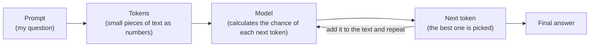

# How LLMs Work

A Large Language Model (LLM) is a computer program that learned from a huge amount of text.
Its job is simple: look at the text so far and guess the next small piece of text.
It repeats this guess again and again until a full answer is built.

## Diagram



Same flow in plain text:

```
Prompt -> Tokens -> Model -> Next token -> (repeat) -> Answer
```

## The steps in my own words

1. **Prompt**: I type a question, for example "What time is the Kakad aarti at Shirdi?"
2. **Tokens**: The question is cut into small pieces called tokens (a word or part of a word). Each token is turned into a number because the computer understands numbers.
3. **Model**: The model reads all the tokens and gives a score to every possible next token.
4. **Next token**: The model picks one token and adds it to the text. Then it reads everything again and picks the next one, until the answer is finished.

## Important things to remember

- The model does not "know" facts like a person. It only predicts what text is likely to come next.
- Because of this it can sometimes make up wrong answers. This is called **hallucination**.
- The model only learned up to a certain date, so it may not know new timings or room prices.

## Why this matters for my ShirdiYatra project

- Shirdi timings and room prices change, so I do not trust the model's memory.
- My app uses my own data from the official site sai.org.in and gives it to the model with the question.
- If my data does not have the answer (like Q6 in my questions list), the app should say "I don't know" instead of guessing.
